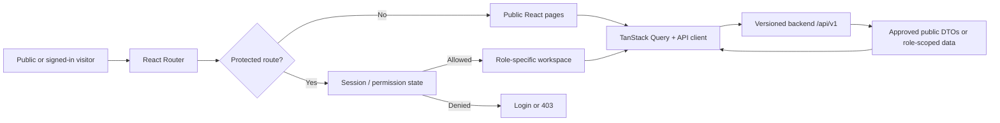
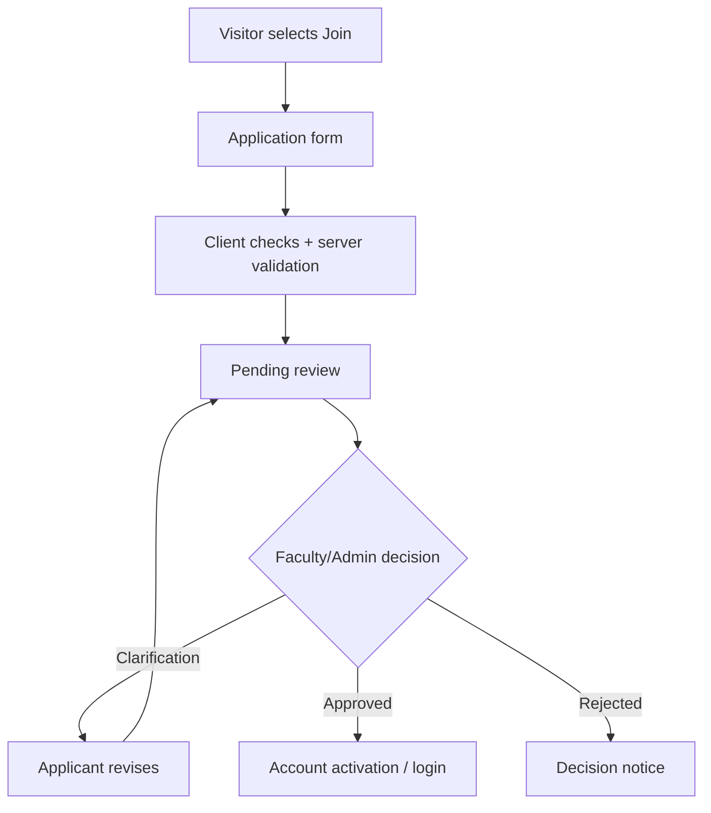

<div align="center">


# FINTECH INNOVATION TEAM PORTAL

### Frontend Engineering · UI/UX System · Motion & Interaction Specification

**A responsive public showcase and a permission-aware digital workspace for students, team leads, mentors, faculty, editors and administrators.**


[Product Vision](#1-product-vision) · [Frontend Features](#3-screen-by-screen-frontend-specification) · [Animations](#8-complete-animation-design-system) · [Getting Started](#13-getting-started) · [API Integration](#10-api-contracts-and-data-handling) · [Team Ownership](#17-eight-member-handoff-contract)

</div>

> **Project maturity notice:** This file is an implementation-ready **frontend specification and GitHub README**, not proof that the application has already been coded, tested or deployed. Sample architecture, theme and animations below are **frontend implementation recommendations**; institutional branding, exact Figma tokens and backend/auth choice must be confirmed with the team.
>
> **Document basis:** *FinTech Innovation Team Portal — 8-Member Ultra-Detailed Implementation Handbook v2*, dated 16 October 2026. The handbook defines eight owners, a public-safe showcase, protected role-based workspaces and reviewer-verified evidence. Animations and suggested frontend libraries in this README are enhancements, not unverified source requirements.

---

## 1. Product vision

The portal has **two clear experiences**:

1. **Public experience** — showcase the institution's FinTech innovation mission, focus areas, approved projects, consenting members, verified hackathon achievements, published magazine issues and a clear **Join Our Team** path.
2. **Private experience** — support applicant approvals, student profiles, team projects, contribution proof, weekly mentor reviews, hackathon records, notifications and authorized management reports.

**Verification is not an animation or a client-side switch.** Data becomes public only after the appropriate backend-controlled approval and publication process. The frontend must never imply that a submission is officially verified before an authorized reviewer verifies it.

### Release boundary

| First release (P0) | Follow-up (P1) | Explicitly outside scope |
| --- | --- | --- |
| Public site, join path, authentication screens, protected role shells, profiles, projects, contributions, weekly reviews, hackathons, approved achievements, notifications, core reports | Full editorial magazine workflow, richer dashboards, enhanced motion/visualizations and optional integrations | Banking transactions, money transfer, payment collection, automatic student-value scoring or replacing an institutional SIS |

<div align="center">
  
</div>

---

## 2. Technology decisions & frontend principles

### Recommended frontend stack (proposed)

| Concern | Technology | Responsibility |
| --- | --- | --- |
| Application | **React + TypeScript** | Type-safe UI, reusable components and feature separation |
| Toolchain | **Vite** | Local development and production bundles |
| Styling | **Tailwind CSS** + CSS custom properties | Token-driven responsive system, stable institutional theming |
| Routing | **React Router** | Public, auth, student, mentor, editor and admin route shells |
| Server data | **TanStack Query** | Fetching, caching, invalidation, retries and async UI states |
| Forms | **React Hook Form + Zod** | Accessible fields and validation; server remains authoritative |
| Animation | **Motion for React** (`motion/react`) | Layout, entry, hover and route choreography |
| Lightweight motion | **CSS transitions/keyframes** | Skeleton shimmer, progress indicators and navigation micro-feedback |
| Optional long-scroll motion | **GSAP + ScrollTrigger** (use sparingly) | Only when Figma and performance justify advanced narrative transitions |
| Icons | **Lucide React** | Consistent outlined icons; named accessible controls |
| Testing | **Vitest + Testing Library + Playwright + axe checks** | Component, flow, responsive and accessibility coverage |
| Data contracts | Shared TypeScript types / Zod schemas | Synchronization with the approved `/api/v1` backend |

**Backend note:** The handbook recommends resolving its inconsistent Node.js versus Spring Boot references before development. Frontend should consume one agreed, versioned API. The suggested full-stack option is **NestJS + PostgreSQL + secure HttpOnly-cookie sessions**, but the team must formally approve it.

### Non-negotiable engineering rules

- **Real content, not fake credibility:** never invent student, award, hackathon or project statistics; use API values, accurate zero states or visibly labeled test fixtures.
- **Secure boundary:** backend performs authentication, authorization, publication/consent filtering and record-level access. React route guards improve UX but are not security controls.
- **Functional first:** forms, filters, tables and state changes must work before adding ornamental effects.
- **Respect motion preferences:** obey `prefers-reduced-motion`, pause nonessential looping animations and never block a workflow behind a transition.
- **Keyboard and touch accessible:** meaningful labels, focus visibility, usable touch targets, predictable Tab order and readable contrast.
- **Responsive from 360px upward:** no sideways scrolling at minimum target width.
- **Asset provenance:** use institution-approved brand assets, consented member photos and public-safe storage URLs only.

---

## 3. Screen-by-screen frontend specification

### 3.1 Public website — primarily Member M01

| Route | Page / UI content | Interaction | Edge cases |
| --- | --- | --- | --- |
| `/` | Branded hero; purpose; focus areas; featured published projects; approved event highlights; verified awards; published magazine preview; Join CTA | Section navigation, scroll-to-content, links to approved details and Join | Loading skeleton; `[]` means genuine empty state, not dummy numbers |
| `/about` | Team mission, institutional context, values, faculty-approved identity | Section navigation, accordions where justified | Long content, mobile wrap, no unapproved claims |
| `/focus-areas` | AI in Finance, Digital Payments, Blockchain, Cybersecurity, Analytics, RegTech | Category filtering and focus detail cards | Screen-reader descriptions, no inaccessible flip cards |
| `/projects` | Approved project cards: title, problem, solution, stack, publish-safe media, status | Search, category filters, sort, pagination, open detail | Private/unpublished projects never appear |
| `/projects/:slug` | Detailed public case study and public evidence summary | Open approved external links, navigation to related projects | Unknown or unpublished slug -> proper 404; no metadata leaks |
| `/students` | Opted-in student cards, skills, public selected contributions | Public-only filters, approved profile link | Withdrawal of consent must remove next fetched result |
| `/students/:slug` | Publish-approved individual profile | Follow public case-study links | Missing/opted-out/suspended profile -> 404 |
| `/hackathons` | Verified participation and public-safe event showcase | Filters, open approved event details | Submitted/unreviewed entries excluded |
| `/achievements` | Officially verified results, approved certificates or links | Search, cards and accessible preview | No self-approved claim shown as verified |
| `/magazine` | Approved issue(s), featured published content, archive | Open/download authorized publication | Draft and private editor notes hidden; full workflow may be P1 |
| `/join` | Application introduction and route to approved join flow | Validation, submit via M02 membership contract | Duplicate, pending, rejected, clarification required feedback |
| `/contact` | Official institution/team contact channels | Approved contact links / form if provided | Never reveal nonconsented personal details |

**Home composition recommendation:** `AnnouncementBar → AccessibleNavbar → Hero → Impact/mission → FocusAreas → FeaturedProjects → VerifiedAchievements → EventHighlights → MagazinePreview → JoinCTA → Footer`. Skip genuinely empty sections only when the editorial policy agrees; otherwise render an honest empty state.

### 3.2 Authentication and membership — Member M02

`/login` · `/verify-email` · `/forgot-password` · `/application-status`

UI states: **Idle → Validating → Submitting → Success / Action required / Error**. For membership: **Pending → Clarification Required / Approved / Rejected**, with approved accounts potentially **Suspended/Inactive**. No protected student access before approval. Ensure login failure and password recovery wording do not reveal whether arbitrary addresses exist.

### 3.3 Student dashboard and profile — Member M03

`/app` · `/app/profile` · `/app/projects` · `/app/contributions` · `/app/weekly` · `/app/hackathons` · `/app/notifications`

Suggested dashboard: greeting, assigned teams, active tasks, contribution summary, current weekly review status, upcoming actions and unread notifications. Every card is sourced from an owned API; no fabricated counters. Profile edit supports save, field errors, success confirmation and publication visibility preferences with clear consequences.

### 3.4 Project, task and contribution workspace — Member M04

Feature sections: project overview, member roster, milestones, task board/table, contribution entry, evidence upload, review status, activity history. Required component patterns include user-friendly pagination, accessible upload progress, async error recovery, status history and audit-linked reviewer identity when permitted.

### 3.5 Weekly progress and mentor reviews — Member M05

`/mentor/reviews` · `/mentor/students/:id` · `/mentor/weekly/:id`

**Draft → Submitted → Under Review → Revision Required / Verified**, including resubmission. A beautiful success animation **never** substitutes for a confirmed backend response. Mentor review UI shows assigned students only. Make revision history and feedback readable and printable.

### 3.6 Hackathons and certificates — Member M06

`/lead/hackathons` · `/lead/hackathons/:id` · `/lead/certificates`

Create/manage teams, participation, event results, supporting documents and member-specific certificates. Clearly separate **self-submitted** from **officially verified**. Certificate document previews must use short-lived authorized URLs; never inline a private storage key.

### 3.7 Admin dashboard and reports — Member M07

`/admin` · `/admin/applications` · `/admin/members` · `/admin/projects` · `/admin/hackathons` · `/admin/reports` · `/admin/settings`

Use compact dashboard KPIs, data tables, search/filter/date range, meaningful status tags, confirmation dialogs, auditable decisions and authorized PDF/XLSX/CSV actions. A **Management Viewer** can see only permitted reports and must not see edit or mutation controls; the API separately enforces this.

### 3.8 Magazine and notifications — Member M08

`/editor/articles` · `/editor/issues` · `/admin/publications`

Article workflow: **Draft → Submitted → Editing / Revision → Approved → Scheduled / Published**. Use public-only issue preview after publication. Notifications use unread/read states, source links, timestamps and sensible empty states. Full editorial experience is a **P1** expansion if the secure MVP needs priority.

---

## 4. User roles & route access

| Role | Example landing | Expected frontend behavior |
| --- | --- | --- |
| Public Visitor | `/` | Read approved public records; access Join/Login |
| Student | `/app` | Edit own profile, submit own updates and contributions |
| Team Lead | `/app`, `/lead/hackathons` | Work on assigned teams/events only |
| Mentor | `/mentor/reviews` | Review assigned students and submissions only |
| Magazine Editor | `/editor/articles` | Draft/edit within editorial permissions; no unilateral public publish |
| Faculty Coordinator / Admin | `/admin` | Review membership/evidence, authorize decisions and reporting |
| Management Viewer | `/admin/reports` | Read permitted reports; no edits |
| Super Admin | `/admin` | Administrate according to institution policy and audit rules |

**Access UX:** loading auth state -> neutral skeleton; unauthenticated protected access -> Login; authenticated but unauthorized -> `403 / Access Denied`; nonexistent routes -> `404`. Do not briefly render protected page content while auth status is unknown.

---

## 5. Proposed repository architecture

The handbook recommends **one repository** for all eight members. This folder tree is a suggested frontend implementation structure, **not a representation of existing files**.

```text
fintech-innovation-team-portal/
├── README.md                            # This frontend documentation
├── docs/
│   ├── assets/
│   │   ├── fintech-hero.gif             # Animated GitHub banner (included)
│   │   └── portal-flow.gif              # Animated workflow visual (included)
│   ├── design-system.md                 # To create and maintain
│   ├── api-contracts.md                 # Agreed DTOs / OpenAPI links
│   ├── role-matrix.md                   # Authorized actions by role
│   └── accessibility-checklist.md
├── apps/
│   ├── web/
│   │   ├── public/
│   │   ├── index.html
│   │   ├── vite.config.ts
│   │   ├── .env.example
│   │   └── src/
│   │       ├── app/
│   │       │   ├── App.tsx
│   │       │   ├── router.tsx
│   │       │   ├── providers.tsx
│   │       │   └── layouts/
│   │       │       ├── PublicLayout.tsx
│   │       │       ├── WorkspaceLayout.tsx
│   │       │       └── AdminLayout.tsx
│   │       ├── assets/                  # Approved static assets only
│   │       ├── components/
│   │       │   ├── common/              # Error, empty, loading, boundaries
│   │       │   ├── data-display/        # Cards, table, chart wrappers
│   │       │   └── navigation/          # Sidebar, navbar, breadcrumbs
│   │       ├── features/
│   │       │   ├── public/              # M01
│   │       │   ├── auth/                # M02
│   │       │   ├── student/             # M03
│   │       │   ├── projects/            # M04
│   │       │   ├── weekly/              # M05
│   │       │   ├── hackathons/          # M06
│   │       │   ├── admin/               # M07
│   │       │   └── magazine/            # M08
│   │       ├── hooks/
│   │       ├── lib/
│   │       │   ├── api.ts
│   │       │   ├── query-client.ts
│   │       │   └── permissions.ts
│   │       ├── motion/
│   │       │   ├── variants.ts
│   │       │   └── useMotionSettings.ts
│   │       ├── styles/
│   │       │   ├── tokens.css
│   │       │   └── globals.css
│   │       └── test/
│   │           └── setup.ts
│   └── api/                              # M02-led backend (future/team-owned)
├── packages/
│   ├── ui/                               # M01 design system (shared)
│   │   └── src/
│   ├── contracts/                        # Shared DTOs, schemas and enums
│   └── config/                           # Shared lint/ts config
├── tests/
│   └── e2e/
│       └── public.spec.ts
└── .github/
    └── workflows/
        └── frontend-ci.yml
```

**Suggested component organization:** keep domain behavior under `features/*`; use `packages/ui` only for reusable primitives and documented patterns. Avoid dumping every component into `components/` and avoid circular imports from shared UI into product-specific features.

---

## 6. Figma-to-React implementation workflow

Existing team design links (provided in the project conversation):

- [FinTech Demo — frame reference A (217:1882)](https://www.figma.com/design/Lr3p1WlqpWXgVklhNV3f9Z/Prathyusha-%E2%80%A2-FinTech-demo-1?node-id=217-1882)
- [FinTech Demo — frame reference B (33:53)](https://www.figma.com/design/Lr3p1WlqpWXgVklhNV3f9Z/Prathyusha-%E2%80%A2-FinTech-demo-1?node-id=33-53)

**Important:** Exact frame colors, font family, spacing and imagery must be inspected and approved directly from Figma before they are treated as final. The theme below is a **suggested temporary motion-oriented palette**, not claimed to be an exact extraction from these frames.

**Conversion procedure**

1. Audit both target frames and establish which correspond to landing, dashboard or other layouts.
2. Record official institution identity rules; export only permitted icons, illustrations, media and fonts.
3. Measure desktop/mobile breakpoints, spacing, corner radius, typography and layer hierarchy.
4. Map each Figma component to a reusable React component and document `props`, states and variants.
5. Rebuild semantic HTML with CSS Grid/Flexbox; do not paste a full-page screenshot or rely on absolute positions for primary layout.
6. Wire interactions and API-backed states before adding cinematic polish.
7. Match the design visually on phone/tablet/desktop; compare rendered screenshots against the actual frame.
8. Add motion only where it improves wayfinding, hierarchy, feedback or storytelling.
9. Validate reduced motion, focus navigation, latency and error states.
10. Obtain team/faculty sign-off before changing official branding.

---

## 7. Visual design & component system

### Suggested temporary palette — replace with approved Figma / institutional tokens

```css
/* apps/web/src/styles/tokens.css — sample, not approved brand colors */
:root {
  --surface-0: #07111f;
  --surface-1: #101e32;
  --surface-2: #162740;
  --surface-raised: rgba(21, 39, 63, 0.92);
  --text-primary: #f4f8ff;
  --text-secondary: #b6c7db;
  --accent-primary: #62e6e0;
  --accent-secondary: #9b8bff;
  --focus-ring: #f2d76b;
  --border-subtle: rgba(183, 204, 227, 0.20);
  --radius-card: 18px;
  --radius-control: 12px;
  --container-max: 1280px;
  --duration-fast: 120ms;
  --duration-base: 220ms;
  --duration-page: 360ms;
  --ease-standard: cubic-bezier(.22, 1, .36, 1);
}
```

### UI components that M01 must publish for other members

| Component | States / props to document | Accessibility requirement |
| --- | --- | --- |
| `AppButton` | variant, size, disabled, loading, icon slots | Actual button/link semantics; name and disabled state |
| `AppNavbar` | route state, public/auth links, menu state | Escape closes drawer; focus management; landmarks |
| `WorkspaceSidebar` | role-aware items, collapsed/expanded | Keyboard operable, active route announced |
| `Card` / `ProjectCard` | content and selectable state | Entire card is not nested clickables; readable title |
| `StatusBadge` | approved/pending/revision/verified | Text label in addition to color |
| `DataTable` | loading, sort, empty, pagination, row action | Headers, keyboard navigation, concise cell labels |
| `FormField` | error, hint, required, disabled | Label associated with control, errors referenced |
| `FileUpload` | progress, rejected file, completion | Limits announced, progress conveyed as text |
| `Modal` / `ConfirmDialog` | open, busy, confirm, cancel | Escape behavior, focus containment and return |
| `Toast` / `InlineAlert` | success, warning, error | Appropriate live-region timing, not animation-only |
| `Skeleton` / `EmptyState` | shape, empty message, retry | No misleading content; motion-safe placeholders |
| `Pagination` / `FilterBar` | page, size, filter state | Form semantics, clear filters and query persistence |
| `ThemeSwitch` (optional) | dark/light, preference | Does not alter approved brand or legibility |
| `MotionSection` | animation variant and trigger | Disabled in reduced-motion mode |

### Layout breakpoints — implementation targets

| Width | Layout | Animation adjustments |
| --- | --- | --- |
| 360–599px | Single column, compact header, stacked CTA, collapsible nav | No scroll hijacking, pointer-tracking or perspective tilt |
| 600–899px | Two-column grids where readable; adaptive sidebar | Limit stagger counts and blurs |
| 900–1279px | Desktop workspace with responsive tables | Full but restrained motion |
| 1280px+ | Max-width content grids, spacious public hero | Optional hero depth/parallax if performant |

**Use CSS media queries and container queries when appropriate; do not infer touch capability from screen width alone.**

---

## 8. Complete animation design system

### 8.1 Design direction

**Premium and purposeful**, not a distracting gaming interface: subtle kinetic typography, soft luminous lines, layered-but-readable cards, calibrated scrolling, confident page changes and clear asynchronous feedback. Motion should communicate **entering**, **changing**, **loading**, **approving**, **rejecting** and **navigating**. No perpetual heavy particles behind protected forms.

### 8.2 Animation choreography matrix (proposed)

All durations are **guidelines**, not measured Figma keyframes.

| ID | Element / event | Motion choreography | Duration / easing | Performance & accessibility |
| --- | --- | --- | --- | --- |
| A01 | First public render | Hero content fade + rise `y:24→0`; illustration subtle scale | 500–650ms, ease-out | Do not hide content before JS settles; reduced motion = visible immediately |
| A02 | Heading reveal | Reveal heading by line / short word group | 450–700ms, ease-out | Preserve semantic text, no huge letter-by-letter delays |
| A03 | Navbar appearance | Header opacity and small vertical translate | 250ms | Avoid shifting document layout |
| A04 | Navbar active link | Animated underline / background indicator | 180–240ms | `aria-current="page"` independent of motion |
| A05 | Mobile menu opening | Backdrop fade; drawer translate from logical edge | 240–320ms | Trap/manage focus appropriately; Escape closes |
| A06 | CTA hover | Border/glow emphasis + translate `y:-2px` | 140–180ms | Hover is optional; clear keyboard focus ring |
| A07 | CTA click | Press scale `1→0.98→1` | 120ms | Do not block route change or submit |
| A08 | Section in viewport | Fade + `y:20→0` once | 380–500ms | IntersectionObserver or Motion `whileInView` with once |
| A09 | Feature cards | Stagger child cards by 60–90ms | 320–450ms each | Cap stagger on long lists; no data delay |
| A10 | Project-card hover | Elevation, border-color, subtle image zoom | 180–250ms | Never apply tilt on touch / reduced-motion |
| A11 | Project filtering | Crossfade/layout shift between real items | 180–280ms | Results count announced; no animation for empty list |
| A12 | Case study detail | Route content fade and slight rise | 250–360ms | Maintain focus after navigation |
| A13 | Statistics | Optional count-up **from actual API total** | ≤900ms | Keep exact value accessible; do not animate invented values |
| A14 | Timeline / workflow | Line draws on entry; states highlighted sequentially | 500–900ms | Static equivalent for reduced motion |
| A15 | Form focus | Border color + outline transition | 120–160ms | Keep high-contrast focus even if motion disabled |
| A16 | Form field error | Soft icon/label appearance, no aggressive shake | 120–180ms | Error text tied to field; not color-only |
| A17 | Form submission | Spinner or determinate progress, then server-confirmed result | State-driven, not fixed countdown | Disable duplicate submit; preserve error retry |
| A18 | Review status change | Transition status chip after successful mutation | 200–320ms | Verify API success before success/verified UI |
| A19 | Notification delivery | Toast slight slide/fade and optional icon | 200–250ms | Announced via ARIA; can persist for critical action |
| A20 | Modal open/close | Backdrop alpha + content scale `0.98→1` | 160–230ms | Focus management; no layout jump |
| A21 | Upload progress | Smooth width interpolation from server upload progress | Continuous by events | Show numeric status; do not fake completion |
| A22 | Skeleton state | Optional low-contrast shimmer | 1.5s loop | Disable in reduced motion; show real wait status |
| A23 | Dashboard charts | One-time path/column grow from zero on valid data | 350–550ms | Accessible table/data alternative; no misleading axes |
| A24 | Magazine issue cards | Subtle cover hover & approved issue reveal | 180–280ms | Only published issues; no flashing effects |
| A25 | Scroll-to-section | Native smooth scroll after user action | Browser controlled | `scroll-behavior: auto` when reduced-motion |
| A26 | Success state | One short checkmark / icon transition | ≤450ms | Only after accepted backend response |

### 8.3 React Motion variants — usable reference code

Install into the React app **after** it has been initialized:

```bash
npm install motion
```

`apps/web/src/motion/variants.ts`:

```ts
import type { Variants } from "motion/react";

export const fadeUp: Variants = {
  hidden: { opacity: 0, y: 20 },
  visible: {
    opacity: 1,
    y: 0,
    transition: { duration: 0.48, ease: [0.22, 1, 0.36, 1] },
  },
};

export const staggerContainer: Variants = {
  hidden: {},
  visible: {
    transition: { staggerChildren: 0.075, delayChildren: 0.06 },
  },
};

export const hoverLift = {
  y: -4,
  transition: { duration: 0.18, ease: "easeOut" as const },
};
```

`apps/web/src/components/common/MotionSection.tsx`:

```tsx
import type { PropsWithChildren } from "react";
import { motion, useReducedMotion } from "motion/react";
import { fadeUp } from "../../motion/variants";

type MotionSectionProps = PropsWithChildren<{ className?: string }>;

export function MotionSection({ children, className }: MotionSectionProps) {
  const reduceMotion = useReducedMotion();

  return (
    <motion.section
      className={className}
      initial={reduceMotion ? false : "hidden"}
      whileInView="visible"
      viewport={{ once: true, amount: 0.16 }}
      variants={reduceMotion ? undefined : fadeUp}
    >
      {children}
    </motion.section>
  );
}
```

**Note:** `MotionSection` is a sample behavior; for critical above-the-fold content prefer no initial hidden state when SSR is not in use or when visibility before hydration matters. Always test accessible reduced-motion behavior and no-JS fallbacks according to project requirements.

### 8.4 Card interaction — usable reference

```tsx
import { motion, useReducedMotion } from "motion/react";
import { Link } from "react-router-dom";

type ProjectCardProps = {
  slug: string;
  title: string;
  summary: string;
};

export function ProjectCard({ slug, title, summary }: ProjectCardProps) {
  const reducedMotion = useReducedMotion();

  return (
    <motion.article
      whileHover={reducedMotion ? undefined : { y: -4 }}
      transition={{ duration: 0.18 }}
      className="rounded-2xl border border-slate-700 p-6"
    >
      <h3 className="text-xl font-semibold">
        <Link to={`/projects/${encodeURIComponent(slug)}`}>{title}</Link>
      </h3>
      <p className="mt-2 text-slate-300">{summary}</p>
    </motion.article>
  );
}
```

The backend's **public DTO** must guarantee this card describes a published project; filtering only by `isPublished` in React is insufficient.

### 8.5 Page transitions and focus management

- Use route-level lazy loading and Suspense fallbacks.
- Prefer entry-only transitions; exit animations must not block urgent route navigation.
- Restore/focus `<h1>` or route main landmark after navigation, and announce route change where assistive technology requires it.
- Keep query-derived filter state during back/forward navigation.
- Ensure dialog `Escape`, focus restoration and screen-reader announcements work without animations.
- Never animate password inputs, private records or modal overlays in a way that flashes sensitive content.

### 8.6 CSS reduced-motion contract

```css
html { scroll-behavior: smooth; }

@media (prefers-reduced-motion: reduce) {
  html { scroll-behavior: auto; }
  *, *::before, *::after {
    animation-duration: 0.01ms !important;
    animation-iteration-count: 1 !important;
    transition-duration: 0.01ms !important;
    scroll-behavior: auto !important;
  }
}
```

This is a defensive baseline only. Code-driven Motion/GSAP effects **must explicitly respect** reduced motion, too. Avoid using a blanket CSS rule as the sole implementation.

### 8.7 Animation performance budget

- Prioritize `transform` and `opacity`; avoid repeated layout-affecting `top/left/width` animations and heavy `filter: blur` on full-screen regions.
- Target smooth **60 FPS** on capable devices, but prioritize usability over that number. Profile on low-power phones.
- Avoid continuous background WebGL/canvas as an MVP prerequisite. If a hero canvas is later approved, load it lazily, cap DPR and provide static fallback.
- Set `will-change` only on elements actually animating and remove it afterward; excessive usage wastes memory.
- Limit simultaneous viewport reveals, live charts and hover effects to keep input responsive.
- Use native lazy-loading for public media and size-constrained, approved images.
- Inactive tabs and offscreen sections should not run continuous decorative loops.
- Test keyboard focus during every animated overlay and route transition.

---

## 9. Frontend data flow and state architecture



### App-level state ownership

| State | Source of truth | Suggested tool |
| --- | --- | --- |
| Current session, role, permissions | Server `/auth/me`; refreshed after login/logout/role changes | Query or server-hydrated auth provider |
| Public published content | Backend public endpoints | TanStack Query |
| Projects, weekly, hackathon records | Module-owned backend endpoints | TanStack Query |
| Forms and temporary draft inputs | Current form scope | React Hook Form; save draft via server if required |
| Filters, pagination, search | URL query parameters when shareable | React Router search params |
| Active dialog / mobile drawer | Local component state | `useState` |
| Toasts and transient confirmation | UI provider | Local toast system |
| Permission and verification decisions | **Server** | Never invent client-owned booleans |

---

## 10. API contracts and data handling

The handbook proposes a versioned JSON API and a common envelope. **Endpoints shown below are planning contracts to agree with module owners**, not verified live routes.

### Public read endpoints

| Resource | GET | Owner / rule |
| --- | --- | --- |
| Focus areas | `/api/v1/public/focus-areas` | Approved site content — M01/M07 |
| Projects | `/api/v1/public/projects` | Only approved/publishable — M04/M07 |
| Project details | `/api/v1/public/projects/:id` | Return 404 for nonpublic record — M04 |
| Student showcase | `/api/v1/public/students` | Individual opt-in and public projection — M03/M07 |
| Hackathons | `/api/v1/public/hackathons` | Only approved/verified outcomes — M06 |
| Achievements | `/api/v1/public/achievements` | Verified/publication-approved — M06/M07 |
| Magazine | `/api/v1/public/magazine` | Published issues only — M08 |

### Example API response shape

```json
{
  "data": [
    {
      "id": "example-project-id",
      "slug": "example-public-project",
      "title": "Example published project",
      "summary": "A sample payload for contract discussion, not a real team achievement."
    }
  ],
  "meta": { "page": 1, "pageSize": 12, "total": 1 }
}
```

```json
{
  "error": {
    "code": "NOT_FOUND",
    "message": "The requested public record was not found.",
    "details": null
  }
}
```

### Client example with session cookies

```ts
// apps/web/src/lib/api.ts — illustrative wrapper
const API_BASE_URL = import.meta.env.VITE_API_BASE_URL ?? "/api/v1";

export async function apiGet<T>(path: string): Promise<T> {
  const response = await fetch(`${API_BASE_URL}${path}`, {
    method: "GET",
    credentials: "include", // Secure HttpOnly session cookie, if agreed
    headers: { Accept: "application/json" },
  });

  const payload: unknown = await response.json().catch(() => null);
  if (!response.ok) {
    throw new Error(`Request failed (${response.status})`);
  }
  return payload as T; // Validate external JSON with a shared Zod schema in production
}
```

**Production notes:** implement appropriate CSRF defenses for cookie-authenticated mutations, secure cookie settings, rate limiting and backend RBAC. Never store auth secrets or privileged tokens in Vite `VITE_*` variables. Any `VITE_*` variable is bundled into client code.

### Async state handling for every route

`loading → success (nonempty) | success (empty) | recoverable failure | permission denied`.

Include a visible **Retry** button for suitable read failures, user-friendly error copy for network/server issues, and accessible skeletons. Aborted/obsolete queries must not overwrite fresh results. All status transitions require the backend's confirmed response before final UI messaging.

---

## 11. SEO, media, privacy and accessibility

### Public SEO

- Descriptive page titles and metadata for publishable public sections.
- Semantic heading order and descriptive internal links.
- Open Graph images only from approved public assets, with stable canonical URLs after hosting is agreed.
- Appropriate robots rules for protected admin/student pages.
- Dynamic route hosting fallback and public 404 pages configured on deployment.

### Privacy & security

- Only serve **allowlisted public DTO fields**; client-side redaction cannot sanitize a private backend response.
- Never expose register numbers, private contacts, mentor notes, student evidence or unapproved certificates on public routes.
- Images of students require consent and publication approval. Support withdrawal by clearing/refetching relevant public caches.
- Don't render insecure markdown/HTML or trust user input; handle untrusted rich content with a vetted safe renderer.
- Do not leak signed private storage URLs into public markup or logs.
- Backend enforces object ownership, reviewer assignment, verification permissions and session revocation.
- Admin decisions need confirmation, server audit and idempotency/conflict handling as appropriate.

### Accessibility acceptance

- WCAG 2.2 AA target (team recommendation); check actual institutional requirements.
- Accessible contrast in every color mode, with actual color-token measurements.
- Logical Tab and heading order, semantic table headers, dialog accessibility, skip-to-content link.
- Live regions for async feedback; labels/errors for every input.
- Full keyboard-only journeys for Join, Login, Search, Filters, Weekly submission and Mentor review.
- Device/accessibility preference honoring: reduced motion, text zoom, larger font, mobile screen reader.

---

## 12. Functional workflows — end to end

### 12.1 Membership application



### 12.2 Contribution and review

`Member logs project work → attaches authorized evidence → submits → mentor/faculty review → revision or verified record → eligible public projection if separately publish-approved.`

### 12.3 Weekly progress

`Draft → Submit → Under Review → Revision Required → Resubmit → Verified`. The status chip, action button, reviewer notes and notifications must all reflect the **same server state**.

### 12.4 Magazine publication

`Draft → Editorial revision → Faculty/Admin approval → Published issue → Public magazine listing`. Magazine editorial richness can be P1, but public content must still respect publication state at MVP.

---

## 13. Getting started

> This package ships documentation and GitHub GIF assets. **It does not ship an initialized React application.** The commands below are for building the application structure described above.

### Prerequisites

- Current supported **Node.js LTS** and npm, or a team-approved pnpm version.
- Git and VS Code (or another TypeScript-capable editor).
- Team-approved API base URL, role matrix and Figma access.
- Institution-approved logo/media assets and permissions.

### Start a standalone React frontend from scratch

```bash
npm create vite@latest fintech-portal-web -- --template react-ts
cd fintech-portal-web
npm install
npm install react-router-dom @tanstack/react-query motion lucide-react \
  react-hook-form zod @hookform/resolvers
npm install -D tailwindcss @tailwindcss/vite vitest @testing-library/react \
  @testing-library/jest-dom @testing-library/user-event jsdom
npm run dev
```

**If using the proposed 8-member monorepo**, put the scaffold in `apps/web`, keep the package manager consistent across the repository and create workspace configuration plus shared packages before running workspace-level commands. Do not run `pnpm --filter ...` until the team has created an actual pnpm workspace.

### Example local environment variables

```dotenv
# apps/web/.env.example  — public client configuration only
VITE_API_BASE_URL=http://localhost:3000/api/v1
VITE_APP_NAME=FinTech Innovation Team Portal
# Never put database credentials, service keys or session secrets here.
```

Configure CORS/credentials properly if the API and frontend use different origins. Use the institution's approved environments and secure cookie settings in staging/production.

### Suggested npm scripts (define these in `apps/web/package.json`)

```json
{
  "scripts": {
    "dev": "vite",
    "build": "tsc -b && vite build",
    "preview": "vite preview",
    "test": "vitest run",
    "test:watch": "vitest",
    "typecheck": "tsc --noEmit",
    "lint": "eslint ."
  }
}
```

Install/configure ESLint, Vitest and TypeScript settings to match the scripts before claiming they all pass. `npm run dev` comes from the Vite scaffold; extra quality scripts require the corresponding configuration files.

---

## 14. Development phases & integration schedule

The 8-week sequence below follows the handbook's implementation planning and **does not claim these milestones are already complete**.

| Week | Frontend output | Integration / proof |
| --- | --- | --- |
| W1 | Figma audit, approved logo/content, wireframes, tokens, mobile + desktop layouts | Brand/layout approval; shared routes and contracts discussed |
| W2 | Public shell, Navbar/Footer, accessible responsive menus, Home/About/Focus | M01/M02 route handoff; 360px smoke check |
| W3 | Public projects/details, Search/Filters, initial UI library, mocked contract fixtures | M04 agrees public DTO, 404/public-only rules |
| W4 | Public students, verified events/awards, shared forms/status table components | M06 consent and verification cases; M03/M07 UI adoption |
| W5 | Replace fixtures with agreed live public APIs; start secure cross-role integration | No fabricated data; auth and permission checks |
| W6 | Automated component/e2e tests, keyboard audits, mobile/tablet responsive fixes | CI evidence, 401/403/404 and empty-state tests |
| W7 | Staging end-to-end testing, regression fixes, motion/performance pass | Screenshots and approved workflows demonstrated |
| W8 | Release checklist, public content permission review, handover and faculty UAT | Reviewer sign-off and known-issues handover |

### Minimum sprint/demo evidence

- A screen recording demonstrating a public visitor browsing approved projects and navigating to Join.
- A screenshot at approximately **360px**, tablet width and desktop width.
- A test showing an unpublished or withdrawn profile **does not appear**.
- A test showing a public API `[]` result gives an honest empty state.
- A keyboard-only run and reduced-motion mode capture.
- A failing API request demonstrating retry/error handling.

---

## 15. Testing strategy & executable acceptance criteria

### Unit / component

- Buttons: disabled/loading/focus/keyboard states.
- Form fields: label/error/hint association, required validation, submit prevention.
- Public card: missing media fallback, long title, no nested invalid links.
- Status chip: readable text, correct mapping from backend enum.
- Shared dialog: Escape, focus return, confirmation semantics.
- Motion components: no entry blockers and reduced-motion fallback.

### Integration

- Public DTO only: rejects accidental private fields at rendering contract boundary (also enforce server allowlist).
- `401/403/404/409/422/500` display safe, useful states.
- Search, filters and pagination preserve URL state and read count correctly.
- Session changes and role revocation invalidate protected queries.
- Published-only magazine/cards and consent withdrawal on refetch.

### Playwright E2E — minimum scenarios

| Test ID | Scenario | Expected result |
| --- | --- | --- |
| M01-AT01 | Fresh anonymous visitor opens all public routes | Public approved content loads without login |
| M01-AT02 | Visitor guesses private project URL | Public `404`, no private partial data |
| M01-AT03 | Student withdraws public consent | Student missing on next public refetch |
| M01-AT04 | Screen at 360px | No horizontal overflow or clipped CTA |
| M01-AT05 | Keyboard/screen reader walkthrough | Labels, visible focus and meaningful link names |
| M01-AT06 | API returns empty list | Honest empty state, no imaginary featured cards |
| M01-AT07 | Public image returns 404 | Local fallback image and alt text work |
| M01-AT08 | Deep link refreshed on staging | Correct route; SPA fallback configured |
| FE-AT09 | User selects reduced motion | No forced parallax, tilt or prolonged entrance delay |
| FE-AT10 | Signed-out user opens `/admin` | Redirect/access path without data leak |
| FE-AT11 | Student opens unauthorized mentor record | 403 and no protected payload rendered |
| FE-AT12 | Backend rejects verification mutation | No success or verified animation shown |
| FE-AT13 | Bad/slow network | Real loading, timeout/error and retry UX |
| FE-AT14 | Modal/menu keyboard navigation | Escape and focus return work |

### Quality gates before merge

```bash
# Run after scripts/configuration have been set up
npm run typecheck
npm run lint
npm run test
npm run build
```

Run Playwright smoke coverage on staging or an isolated mocked environment. Capture evidence in PR and never treat a successful build as proof of privacy or authorization.

---

## 16. Animation implementation checklist

- [ ] Main hero appears without layout shift or long blocking intro.
- [ ] Real text and CTA remain readable while visuals animate.
- [ ] Navbar indicator tracks the active route.
- [ ] Scroll reveals use intersection awareness and do not keep running.
- [ ] Project cards elevate subtly on pointer hover but remain fully keyboard usable.
- [ ] Search/filter animation reflects the **actual response**.
- [ ] Status changes animate only after server confirmation.
- [ ] Toast and errors are announced nonvisually.
- [ ] Reduced-motion disables decorative movement and auto-scrolling.
- [ ] All dialogues restore focus correctly.
- [ ] Mobile experience does not depend on hover or 3D cursor movement.
- [ ] Loading animation never disguises a hung request.
- [ ] CPU/GPU use is profiled on entry-level Android and typical laptop hardware.
- [ ] Motion changes are reviewed alongside functional changes and tested after refactors.

---

## 17. Eight-member handoff contract

| Owner | Module ownership | Frontend work and dependency on M01 |
| --- | --- | --- |
| **M01** | Public Website & Shared UI/UX | Public pages, tokens, layouts, accessible navigation, core shared UI, animation conventions; consumes approved M04/M06/M08 data |
| **M02** | Authentication & Membership | Join/Login/approval status interfaces; owns permission/session contract, receives shared FormField, dialog and Access Denied patterns |
| **M03** | Student Dashboard & Profile | Student shell, profile, public visibility; receives common layout/card/form primitives |
| **M04** | Project, Task & Contribution | Project/board/evidence UIs; supplies published project summaries, not private data |
| **M05** | Weekly Progress & Mentor Review | Submission/review screens with state-aware status components |
| **M06** | Hackathons & Certificates | Event, teams, outcomes and verified public achievements for showcase |
| **M07** | Admin Dashboard & Reports | Tables, filters, confirmations, permitted exports; approves publication controls |
| **M08** | Magazine & Notifications | Issue/archive/editor UI, alerts, publication-safe public magazine feeds |

### M01's eight scoped GitHub issues from the handbook

| Issue | Priority | Acceptance focus |
| --- | --- | --- |
| `M01-T01` | P0 | Tokens, typography, responsive grid, layout and brand review |
| `M01-T02` | P0 | Home/About/Focus/Join/Contact with honest UI states |
| `M01-T03` | P0 | Approved projects showcase, details and filters |
| `M01-T04` | P0 | Consenting innovators, events and verified achievements |
| `M01-T05` | P0 | Consent/publication visibility rules and safe content |
| `M01-T06` | P1 | Public magazine archive/listing |
| `M01-T07` | P0 | Mobile navigation, accessible forms, error/loading patterns |
| `M01-T08` | P0 | Visual regression, responsive/keyboard checks and guidelines |

### Suggested pull-request convention

`feat(M01): build public projects cards with published DTO`  
`feat(M02): implement membership form and states`  
`fix(M01): prevent mobile overflow on featured cards`  
`test(M01): ensure unapproved project 404 behavior`

Recommended branch convention: `feature/M01-public-projects`, `fix/M01-mobile-menu`, `feature/M07-report-filters`.

**Definition of Done:** UI + typed contract + loading/empty/error states + role/privacy review + mobile/keyboard tests + integration tests + screenshots + reviewer approval. A nice animation alone never makes a feature complete.

---

## 18. Deployment, security review and release

1. Review role matrix, public DTO allowlist, official branding and media permissions.
2. Run static checks, test suite, build and staging e2e checks.
3. Deploy frontend to an institution-approved static host; configure API origin and SPA history fallback.
4. Use HTTPS and correct API cookie/CORS/CSRF controls; do not put secrets into Vite env values.
5. Test a new visitor, pending applicant, approved student, mentor, editor, admin, management viewer and suspended user.
6. Validate unpublished projects, unpublished magazine issues and revoked student consent do **not** leak.
7. Monitor network errors and accessible UX; include a rollback strategy and release notes.
8. Obtain institution/faculty production sign-off.

### Suggested performance indicators (targets, not measured results)

| Metric | Suggested first target | Validation method |
| --- | --- | --- |
| Mobile performance | Consistently usable on entry-level phones | Throttled browser profile + real device |
| Core Web Vitals | Good thresholds where measurable | Lighthouse + field RUM after permission approval |
| Interaction animation | Smooth transform/opacity; no dropped-input delays | DevTools Performance |
| Bundle growth | Route-level code splitting, no surprise heavy animation chunks | Vite bundle report |
| Error recovery | Every API-dependent page offers a usable response | Throttled/failed network tests |
| Accessibility | Keyboard and screen-reader critical flows pass | Automated axe + manual testing |

---

## 19. Source alignment vs. visual enhancements

| Source-backed project requirements | Frontend proposal in this README |
| --- | --- |
| Public home, focus areas, approved projects, consented members, verified awards, magazine, Join | Premium dark/glass motion example and animated GIF README hero |
| React + TypeScript frontend, role-aware pages, protected data and responsive layout | Vite + Tailwind + React Router + TanStack Query + Motion |
| Shared component library and public/private permissions | Token sample, animation matrix, variants and UI testing strategy |
| Eight owners, module acceptance tests and staged release | GitHub README structure, animation GIFs and developer onboarding examples |

**Never use this README to claim the Figma has been pixel-matched, the app is live, or backend verification exists unless those claims have been independently tested.**

---

## 20. Delivery checklist & next actions

- [ ] Assign actual team names to M01–M08 and select PR reviewers.
- [ ] Confirm institution branding, approved logo, team name and official contact.
- [ ] Review Figma 217:1882 and 33:53, extract actual design tokens and approve responsive variants.
- [ ] Freeze backend decision, auth/session model, role matrix and public DTO fields.
- [ ] Create monorepo and share component conventions.
- [ ] Build first public Home + navbar + Join links **without invented statistics**.
- [ ] Implement public project cards against approved data fixtures, then live contracts.
- [ ] Apply purposeful Motion and reduced-motion behavior.
- [ ] Test every P0 screen and privacy boundary with the module owner.
- [ ] Capture screenshots, test reports and final acceptance sign-off.

<div align="center">

**BUILD THE INTERFACE. PROTECT THE DATA. VERIFY THE IMPACT.**

*FinTech Innovation Team Portal — Frontend README & Animation Engineering Blueprint · 16 October 2026*

</div>
